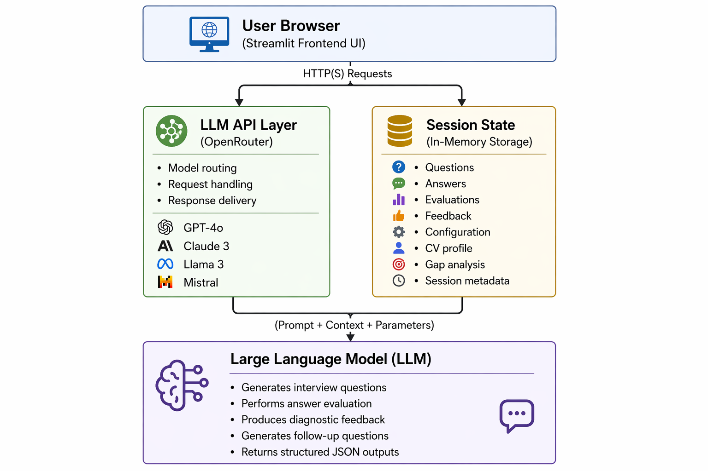
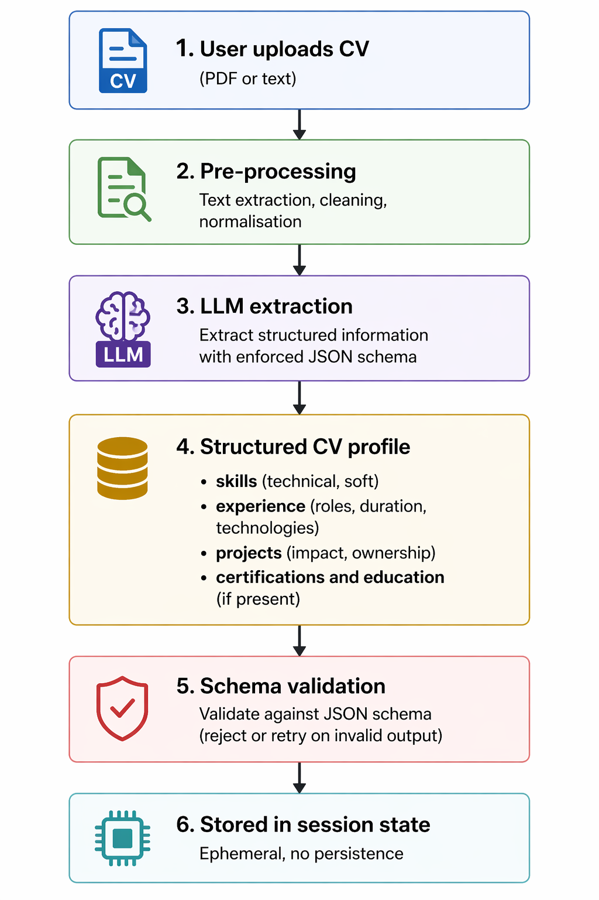
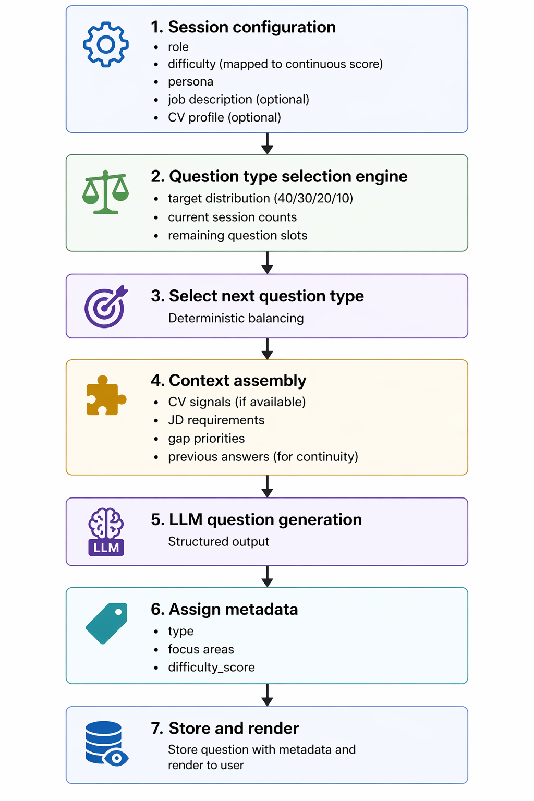
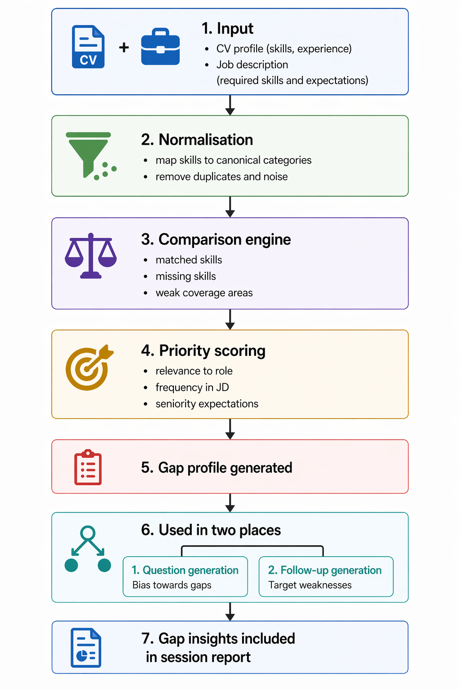

# Architecture & Flow Diagrams

This directory contains visual diagrams for the Interview Practice App architecture.

## Diagrams

### High-Level Architecture

### CV Extraction & Structuring

### Question Generation with Distribution

### Gap Analysis & Targeted Questioning

### Navigation Flow

---

## Related Documentation

- [High-Level Architecture](../high-level-architecture.md)
- [User Interface & Screens](../user-interface--screens.md)