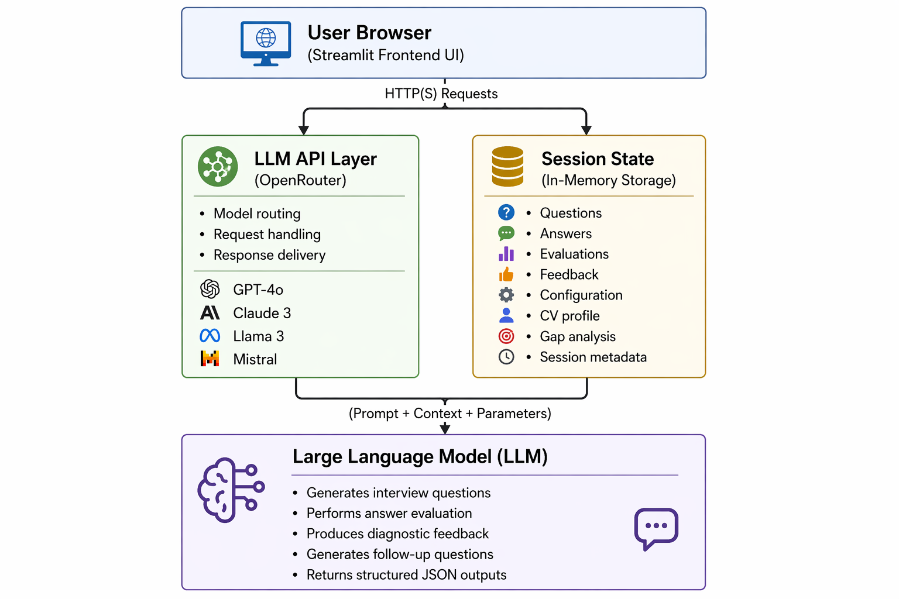
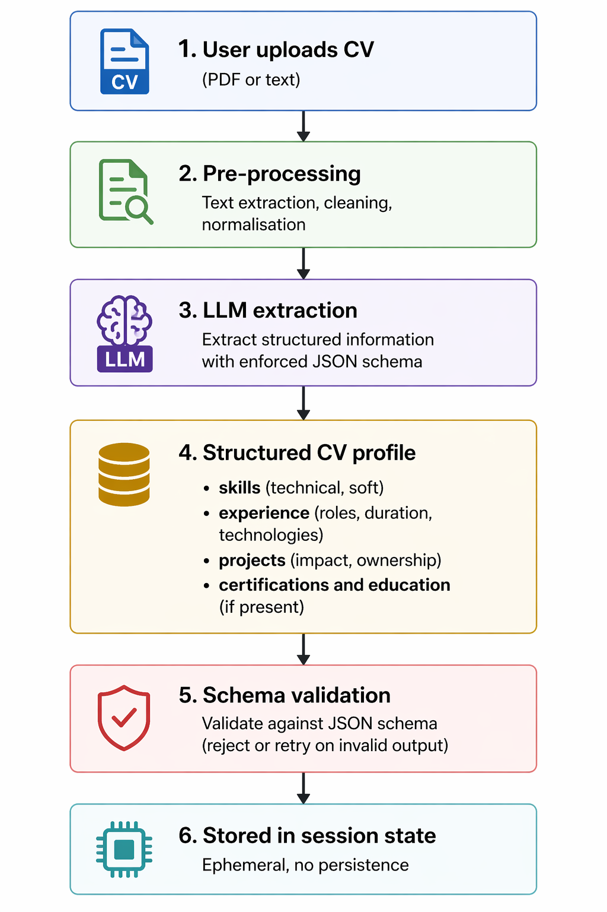
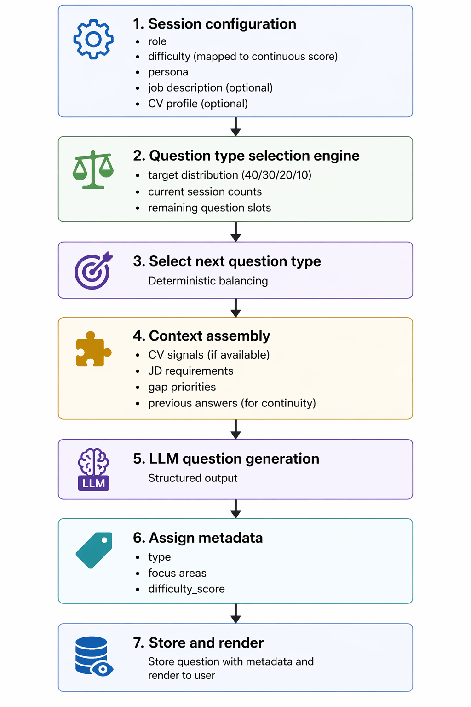
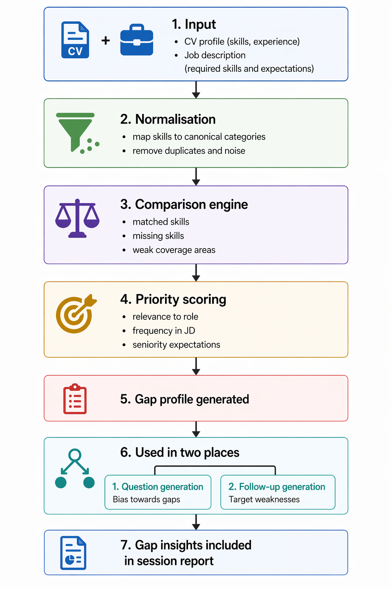

## High-Level Architecture

### System Overview



The architecture supports phased feature rollout. Phase 1 operates as a session-based system with the core interview loop. Later phases add personalisation, advanced evaluation, and growth features without requiring architectural redesign.

### Architectural Responsibilities

**Frontend (Streamlit)**
- Handles user interaction and UI rendering  
- Manages session state lifecycle  
- Orchestrates API calls to the LLM API layer  
- Displays questions, answers, feedback, and reports  

**Session State (In-Memory)**
- Stores all session data for the duration of the session  
- Maintains continuity across screens and interactions  
- Holds configuration data in Phase 1  
- Adds CV profile and gap analysis data in Phase 2  
- Cleared on session expiry or restart  

**LLM API Layer (OpenRouter)**
- Routes requests to selected models  
- Applies model parameters (e.g. temperature)  
- Returns structured responses for downstream parsing  

**LLM (Model Layer)**
- Performs:
  - question generation  
  - answer evaluation  
  - reasoning assessment  
  - follow-up generation  
- Produces structured JSON outputs for deterministic handling  

### Data Flow Overview

1. **User Configuration**
   - User inputs role, difficulty, persona, and response style in Phase 1  
   - Optional CV and job description inputs are added in Phase 2  
   - Stored in session state  

2. **Question Generation**
   - Session context and prompt sent to LLM API  
   - LLM returns structured question  
   - Question stored and rendered  

3. **Answer Submission**
   - Input validated locally  
   - Submitted with full context to LLM  

4. **Evaluation**
   - LLM returns structured evaluation (scores, feedback, follow-up)  
   - Stored in session state and displayed  

5. **Iteration**
   - Follow-up or next question generated based on evaluation  

6. **Reporting**
   - Aggregated session data formatted into basic or advanced PDF/JSON output depending on phase  

### Architectural Constraints

- All LLM interactions enforce structured JSON output for deterministic parsing and UI rendering  
- No persistent database is used in MVP; all data resides in session state  
- Session data is isolated per user and cleared on expiry or restart  

### Technology Stack

| Layer         | Technology                | Purpose                                                   |
| ------------- | ------------------------- | --------------------------------------------------------- |
| Frontend      | Streamlit                 | Interactive UI with minimal frontend overhead             |
| Backend       | Python                    | Application logic, prompt orchestration, API coordination |
| LLM API       | OpenRouter                | Model access and routing across providers                 |
| Deployment    | Docker + Cloud (optional) | Containerised deployment and scalability                  |
| Session State | Streamlit Session State   | In-memory session storage (MVP, no database)              |

### Data Flow

#### 1. Setup Phase

```plaintext
User Input (role, difficulty, persona, JD, CV)
  → Stored in session state
  → Available for downstream processing
```

#### 2. Question Generation

```plaintext
System Prompt
  + User Configuration
  + CV Profile (if available)
  + Gap Analysis (if JD provided)
  + Question Type
  → API call (OpenRouter)
  → LLM returns structured question
  → Stored and rendered in UI
```

#### 3. Answer Submission

```plaintext
User Answer
  → Real-time validation (length, relevance)
  → If valid: proceed
  → If invalid: inline warning (no interruption)
```

#### 4. AI Evaluation

```plaintext
Evaluation Prompt (structured)
  + Question Context
  + User Answer
  → API call (OpenRouter)
  → LLM returns structured JSON:
      - scores
      - feedback
      - improvements
      - example answer
      - follow-up question
  → Parsed and displayed
```

#### 5. Report Generation

```plaintext
Session Data Aggregation
  → Template rendering (Markdown/HTML)
  → Export as PDF or JSON
  → Delivered to user
```

### API Integration

```python
import os
from openai import OpenAI

client = OpenAI(
    api_key=os.getenv("OPENROUTER_API_KEY"),
    base_url="https://openrouter.ai/v1",
)

def call_llm(system_prompt, user_prompt, model="google/gemma-4-31b-it:free", temperature=0.7):
    response = client.chat.completions.create(
        model=model,
        messages=[
            {"role": "system", "content": system_prompt},
            {"role": "user", "content": user_prompt},
        ],
        temperature=temperature,
    )
    return response.choices[0].message.content
```

### JSON Schema & Data Structures

#### Session State Schema

```json
{
  "session_id": "uuid",
  "created_at": "2026-04-23T14:30:00Z",
  "expires_at": "2026-04-24T14:30:00Z",

  "configuration": {
    "role": "Backend Engineer",
    "difficulty": "Medium",
    "persona": "Strict",
    "response_style": "Detailed",
    "temperature": 0.7,
    "job_description": "string (optional)",

    "cv_profile": {
      "skills": {
        "technical": ["Python", "System Design", "Go", "Kubernetes"],
        "soft": ["Communication", "Leadership"]
      },
      "roles": [
        {
          "title": "Senior Backend Engineer",
          "duration_years": 2
        }
      ],
      "projects": [
        {
          "name": "API Optimization",
          "technologies": ["Python", "PostgreSQL", "Redis"],
          "description": "Reduced latency from 2s to 200ms",
          "impact": "10x performance improvement"
        }
      ],
      "experience_years": 6,
      "certifications": ["AWS Certified Developer"],
      "education": "string"
    }
  },

  "questions": [
    {
      "id": "q1",
      "sequence": 1,
      "type": "cv_based|jd_based|behavioural|deep_dive",
      "text": "string",
      "focus_areas": ["Performance", "Ownership"],
      "context": "string (optional)",
      "gap_focus": "string (optional)",
      "difficulty_score": 0.42,
      "timestamp_created": "2026-04-23T14:31:00Z"
    }
  ],

  "answers": [
    {
      "id": "a1",
      "question_id": "q1",
      "text": "string",
      "character_count": 350,
      "timestamp_submitted": "2026-04-23T14:34:00Z",

      "evaluation": {
        "overall_decision": "pass|borderline_pass|fail",
        "confidence": 0.87,

        "scores": {
          "relevance": 7,
          "structure": 4,
          "specificity": 4,
          "communication": 7,
          "problem_solving_approach": 5
        },

        "labels": {
          "relevance": "Addresses question directly",
          "structure": "Needs clearer STAR organisation",
          "specificity": "Lacks measurable outcomes",
          "communication": "Clear and easy to follow",
          "problem_solving_approach": "Reasoning not fully articulated"
        },

        "key_issues": [
          "Missing measurable outcomes",
          "Insufficient explanation of decisions"
        ],

        "improvements": [
          "Include quantifiable impact",
          "Explain reasoning and trade-offs"
        ],

        "example_answer": "string",

        "reasoning_feedback": {
          "clarity": "string",
          "alternative_approaches": "string",
          "trade_off_awareness": "string"
        },

        "follow_up_question": "string"
      },

      "timestamp_evaluated": "2026-04-23T14:38:00Z"
    }
  ],

  "gap_analysis": {
    "cv_skills": ["Python", "System Design", "Go"],
    "jd_requirements": ["Python", "Distributed Systems", "Go", "Cloud Architecture"],
    "missing_skills": ["Distributed Systems", "Cloud Architecture"],
    "weak_areas": ["Cloud platforms"],
    "strength_areas": ["Backend development", "Performance optimisation"],
    "gap_targeted_questions_generated": 1
  },

  "question_type_distribution": {
    "cv_based_asked": 2,
    "jd_based_asked": 2,
    "behavioral_asked": 1,
    "deep_dive_asked": 0,
    "target_distribution": {
      "cv_based": 2,
      "jd_based": 2,
      "behavioral": 1,
      "deep_dive": 0
    }
  },

  "session_stats": {
    "total_base_questions": 5,
    "total_follow_ups": 3,
    "total_answers": 8,
    "average_score": 5.4,
    "duration_minutes": 18,
    "best_dimension": "Communication",
    "weakest_dimension": "Problem-Solving Approach"
  }
}
```

#### CV Extraction Schema

```json
{
  "cv_profile": {
    "raw_text": "string",

    "skills": {
      "technical": ["Python", "Java", "System Design", "Kubernetes"],
      "soft": ["Leadership", "Communication", "Project Management"]
    },

    "experience": [
      {
        "role": "Senior Backend Engineer",
        "company": "TechCorp",
        "start_date": "2022-01",
        "end_date": "2024-01",
        "responsibilities": ["string"],
        "technologies": ["Python", "PostgreSQL", "AWS"]
      }
    ],

    "projects": [
      {
        "name": "API Optimisation",
        "description": "Reduced latency from 2s to 200ms",
        "technologies": ["Python", "Redis", "PostgreSQL"],
        "impact": {
          "metric": "latency",
          "before": "2s",
          "after": "200ms",
          "improvement": "10x"
        },
        "ownership": "Led implementation"
      }
    ],

    "certifications": [
      {
        "name": "AWS Certified Developer",
        "issuer": "Amazon Web Services",
        "year": 2023
      }
    ],

    "education": [
      {
        "degree": "BSc Computer Science",
        "institution": "University Name",
        "year_completed": 2020
      }
    ],

    "total_experience_years": 6,
    "seniority_level": "Senior"
  }
}
```

#### Evaluation Request Schema (to OpenRouter API)

```json
{
  "metadata": {
    "role": "Backend Engineer",
    "difficulty": "Medium",
    "difficulty_score": 0.45,
    "persona": "Strict",
    "response_style": "Detailed"
  },

  "question_context": {
    "question_id": "q1",
    "type": "cv_based|jd_based|behavioral|deep_dive",
    "text": "string",
    "focus_areas": ["Performance", "Ownership"]
  },

  "user_input": {
    "answer": "string",
    "character_count": 350
  },

  "cv_context": {
    "skills": ["Python", "System Design"],
    "experience_years": 6,
    "recent_focus": "Performance optimisation"
  },

  "jd_context": "string",

  "evaluation_constraints": {
    "scoring_scale": "0–10",
    "dimensions": [
      "relevance",
      "structure",
      "specificity",
      "communication",
      "problem_solving_approach"
    ],
    "require_structured_output": true
  }
}
```

#### Evaluation Response Schema (from OpenRouter API)

```json
{
  "evaluation": {
    "overall_decision": "pass|borderline_pass|fail",
    "confidence": 0.87,

    "scores": {
      "relevance": 7,
      "structure": 4,
      "specificity": 4,
      "communication": 7,
      "problem_solving_approach": 5
    },

    "labels": {
      "relevance": "Addresses the question directly",
      "structure": "Needs clearer STAR organisation",
      "specificity": "Lacks measurable outcomes",
      "communication": "Clear and easy to follow",
      "problem_solving_approach": "Reasoning not fully articulated"
    }
  },

  "feedback": {
    "summary": "string",

    "strengths": [
      "Clear communication of the problem"
    ],

    "key_issues": [
      "Missing measurable outcomes",
      "Insufficient explanation of decisions"
    ],

    "improvements": [
      "Include quantifiable impact",
      "Explain reasoning and trade-offs",
      "Discuss alternative approaches"
    ]
  },

  "reasoning_assessment": {
    "clarity": "string",
    "alternative_approaches": "string",
    "trade_off_awareness": "string"
  },

  "example_answer": {
    "text": "string",
    "structure_hint": "STAR|Concise|Detailed"
  },

  "follow_up": {
    "question": "string",
    "type": "probe_gap|probe_strength|clarification",
    "target_dimension": "problem_solving_approach"
  },

  "cv_gap_insights": {
    "identified_gap": "string",
    "suggested_focus": "string",
    "justification": "string"
  }
}
```

#### Session Summary Report Schema

```json
{
  "report": {
    "session_id": "uuid",
    "generated_at": "2026-04-23T14:50:00Z",
    "duration_minutes": 18,

    "configuration": {
      "role": "Backend Engineer",
      "difficulty": "Medium",
      "persona": "Strict"
    },

    "performance_summary": {
      "overall_score": 5.4,
      "max_score": 10,
      "readiness_rating": 0.68,
      "decision": "pass|borderline|fail"
    },

    "scores_by_dimension": {
      "relevance": { "average": 7, "trend": "stable" },
      "structure": { "average": 4.4, "trend": "improving" },
      "specificity": { "average": 4.2, "trend": "improving" },
      "communication": { "average": 6.8, "trend": "stable" },
      "problem_solving_approach": { "average": 5, "trend": "stable" }
    },

    "strengths": [
      "Clear communication of ideas",
      "Relevant use of experience",
      "Strong understanding of domain fundamentals"
    ],

    "weaknesses": [
      "Limited use of measurable outcomes",
      "Inconsistent answer structure",
      "Insufficient explanation of trade-offs",
      "Limited discussion of alternative approaches"
    ],

    "gap_analysis": {
      "identified_gaps": ["Distributed Systems", "Cloud Architecture"],
      "strength_areas": ["Backend Development", "Performance Optimisation"],
      "recommendation": "Focus on distributed systems and scalable architecture scenarios"
    },

    "questions_summary": [
      {
        "sequence": 1,
        "type": "cv_based|jd_based|behavioral|deep_dive",
        "score": 5.4,
        "decision": "pass|borderline|fail"
      }
    ],

    "dimension_trends": {
      "relevance": "stable",
      "structure": "improving",
      "specificity": "improving",
      "communication": "stable",
      "problem_solving_approach": "stable"
    },

    "next_steps": [
      {
        "priority": "high",
        "action": "Use STAR structure consistently in responses"
      },
      {
        "priority": "high",
        "action": "Include measurable impact in all examples"
      },
      {
        "priority": "medium",
        "action": "Practise explaining technical trade-offs"
      },
      {
        "priority": "medium",
        "action": "Prepare distributed systems scenarios"
      }
    ],

    "benchmarking": {
      "peer_percentile": 72,
      "sample_size": 1200,
      "role_cohort": "Backend Engineer",
      "experience_band": "5-8 years",
      "expected_level": "mid_to_senior",
      "gap_to_target": "moderate"
    }
  }
}
```

---

### CV-Aware Interview Engine Architecture

The CV-aware engine extends the core interview system by introducing structured personal context, controlled distribution logic, and targeted evaluation.

#### 1. CV Extraction & Structuring



Key point
Extraction is not complete until schema validation succeeds. This ensures downstream determinism.

#### 2. Question Generation with Distribution



Key point
Distribution is enforced at selection stage, not generation stage. This avoids drift.

#### 3. Gap Analysis & Targeted Questioning



Key point
Gap analysis is not static. It actively influences both question selection and follow-up depth.

---

### Solution Design Choices (What & Why)

#### 1. CV Integration via LLM (Not Rule-Based Parsing)

**What was chosen:** 
- LLM-based extraction with enforced structured JSON output.

**Why:**
- CV formats are highly variable across PDF, text, and layout styles
- Rule-based parsing is fragile and does not generalise across formats
- LLM extraction enables semantic understanding, not just pattern matching
- Supports inference of seniority, domain exposure, and implicit skills
- Reduces maintenance overhead compared to rule-based systems

**Implementation:** #
- OpenRouter LLM with strict JSON schema enforcement
- Validation layer with retry on malformed output
- Output normalised before downstream use (FR-1.7)

---

#### 2. Weighted Question Distribution (40/30/20/10)

**What was chosen:** 
- Deterministic distribution of question types across the session.

**Why:**
- Prevents excessive reliance on CV-driven questions
- Ensures coverage of role expectations, behaviour, and edge scenarios
- Reflects realistic interview structures
- Maintains consistency across sessions
- Supports redistribution where CV is not provided

**Implementation:** 
- Distribution enforced at question selection stage, not generation
- Session-level tracking of counts against target allocation
- Closest-fit allocation applied across 5 base questions (FR-2.5)

---

#### 3. Problem-Solving Approach as a Core Dimension

**What was chosen:** 
- A dedicated evaluation dimension assessing reasoning and decision-making.

**Why:**
- Interviews assess how decisions are made, not only outcomes
- Encourages structured articulation of reasoning
- Supports evaluation of trade-offs and alternative approaches
- Differentiates mid-level from senior-level performance
- Aligns with system design and behavioural interview expectations

**Implementation:** 
- Included as a fifth scoring dimension (FR-4.1)
- Reflected explicitly in feedback and reasoning assessment sections

---

#### 4. CV vs JD Gap Analysis

**What was chosen:** 
- Structured comparison between candidate profile and job requirements.

**Why:**
- Identifies missing or weak skill areas relevant to the target role
- Enables targeted questioning rather than generic coverage
- Reflects real interviewer behaviour in probing gaps
- Provides actionable direction for user improvement
- Increases relevance of both questions and feedback

**Implementation:** 
- Normalisation of CV and JD skills into comparable categories
- Gap identification and prioritisation
- Used to bias question generation and follow-up prompts (FR-4.8)

---

#### 5. Session-Only CV Storage

**What was chosen:** 
- Ephemeral storage of CV data within session state only.

**Why:**
- Avoids retention of sensitive personal data
- Reduces privacy and compliance burden
- Simplifies system architecture for MVP
- Aligns with stateless, session-driven design
- Eliminates need for data lifecycle management

**Implementation:** 
- Stored in Streamlit session state
- Automatically cleared on session expiry or restart (FR-6.1)

---

### Prompt Architecture

#### Master System Prompt (Structured Output)
```
You are an AI interview evaluator. Output ONLY valid JSON.

{
  "evaluation": {
    "overall_decision": "pass|borderline_pass|fail",
    "confidence": 0,
    "scores": {
      "relevance": 0,
      "structure": 0,
      "specificity": 0,
      "communication": 0,
      "problem_solving_approach": 0
    },
    "labels": {
      "relevance": "",
      "structure": "",
      "specificity": "",
      "communication": "",
      "problem_solving_approach": ""
    }
  },
  "feedback": {
    "summary": "",
    "strengths": [],
    "key_issues": [],
    "improvements": []
  },
  "reasoning_assessment": {
    "clarity": "",
    "alternative_approaches": "",
    "trade_off_awareness": ""
  },
  "example_answer": {
    "text": "",
    "structure_hint": "STAR|Concise|Detailed"
  },
  "follow_up": {
    "question": "",
    "type": "probe_gap|probe_strength|clarification",
    "target_dimension": "relevance|structure|specificity|communication|problem_solving_approach"
  },
  "cv_context_summary": "",
  "gap_analysis_summary": ""
}

Rules:
- Scores: int 0–10
- Confidence: 0–1, ≤2 decimals, based on score consistency
- Labels concise, aligned
- strengths, key_issues, improvements: 2–4 items, distinct

Decision:
- avg = mean(scores)
- pass: avg ≥ 7 AND problem_solving_approach ≥ 6
- borderline_pass: avg 5–6.9
- fail: avg < 5 OR problem_solving_approach ≤ 4
- Weak reasoning cannot pass

Reasoning:
- Assess clarity, alternatives, trade-offs explicitly
- Penalise implicit reasoning

Ordering:
- issues: highest impact first
- improvements: map to issues
- strengths: strongest first

Example_answer:
- 80–200 words, structured, includes actions + reasoning + outcomes

Follow_up:
- probe_gap = weakness
- probe_strength = deepen strength
- clarification = missing detail

Constraints:
- All fields required
- No nulls (use "" or [])
- JSON only
- If invalid → regenerate internally
```

#### Question Generation Prompt (Few-shot)
```
You are an AI interviewer. Output JSON only:

{
  "question": "",
  "focus_areas": [],
  "context": ""
}

Context:
Role:{role} Difficulty:{difficulty} Persona:{persona}
JD:{jd} CV:{cv_profile}
Type:{question_type} Gap:{gap_focus}

Rules:
- Scenario-based only (no theory)

Difficulty:
- Easy: clear
- Medium: applied
- Hard: must include trade-offs/constraints

Type:
- cv_based: use CV
- jd_based: use JD
- behavioral: communication/decisions
- deep_dive: edge cases/trade-offs

Gap:
- If present → MUST target

Persona:
- Friendly/supportive
- Neutral/balanced
- Strict/direct

Quality:
- Clear context
- Implied depth
- Encourage reasoning

Validation:
- focus_areas: 2–4 items
- JSON only
```

---


