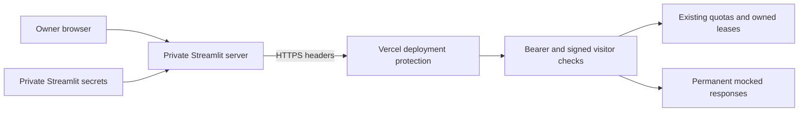

# Streamlit Community Cloud demonstration deployment proposal

18 November 2026 (Europe/Berlin). **Preparation only: do not deploy or push yet.**

## Verified backend and readiness

Use the verified protected mock Preview, not an older project alias:
`https://interviewiq-api-preview-28ndht991-roomas-projects.vercel.app`.
Deployment `dpl_3XLLkftWMZQx7U8bJwjXJG6NraRt`, published source `e247aba`;
[complete hosted workflow evidence](hosted-workflow-recovery-results.md).
The historical second-question blocker is resolved. Backend bytes and protection
are unchanged by this frontend preparation. No new backend test request is made.

The published `e247aba` frontend does not yet contain all demonstration/configuration
changes. Deploy only a separately approved, scoped frontend release derived from it.
The candidate tree, exact file inventory and patch are recorded in
[preparation verification](streamlit-community-cloud-verification.md). Pending unrelated
renames/documentation changes are excluded; no merge into main is proposed.

## Exact proposed Community Cloud settings

| Field | Value |
| --- | --- |
| GitHub repository | `roomariz/interview-iq` (existing public repository) |
| Branch | `feat/streamlit-vercel-backend`, after approved scoped publication |
| Main file path | `deployment/streamlit/app.py` |
| Python, selected explicitly | `3.12` |
| Requested app subdomain | `interviewiq-demo`; availability unverified; do not select an alternative automatically |
| Workspace | User's personal Community Cloud workspace connected to `roomariz`; verify account before creation |
| Sharing after activation | Owner/developers only; no viewer invitations or public release |
| Frontend dependencies | `deployment/streamlit/requirements.txt`: `-r ../../requirements-frontend.txt` |
| Configuration file | Root `.streamlit/config.toml`, existing theme only |
| Local equivalent command | `streamlit run deployment/streamlit/app.py` from repository root |

The entrypoint directory's requirements take precedence over root requirements;
execution starts from repository root. The root backend/dev requirements are not
selected for this app. [Dependency precedence](https://docs.streamlit.io/deploy/streamlit-community-cloud/deploy-your-app/app-dependencies),
[root execution and configuration](https://docs.streamlit.io/deploy/streamlit-community-cloud/deploy-your-app/file-organization).

Pinned frontend manifest: Streamlit 1.67.0, Pydantic 2.10.0, HTTPX 0.27.2,
Requests 2.33.0, Starlette 1.3.1, Pillow 13.0.0, AnyIO 4.16.0,
Certifi 2026.10.23, IDNA 3.20, urllib3 2.8.0 and pandas 2.2.0.
No OpenAI/Google SDK, FastAPI, Playwright, provider key or Redis credential
is needed by this frontend. Uvicorn is a normal transitive requirement of
Streamlit 1.67 itself; no standalone backend dependencies are selected. No system `packages.txt` is required.
Select Python and the repository fields in the deployment dialog;
[official deployment settings](https://docs.streamlit.io/deploy/streamlit-community-cloud/deploy-your-app/deploy).

## Access control and safe first creation

A public repository produces a public app initially. Community Cloud supports
switching to restricted viewers and permits one private app at a time.
[Official sharing controls](https://docs.streamlit.io/deploy/streamlit-community-cloud/share-your-app).

After approval, create the first app **without usable backend secrets**. Its
configuration guard stops before the welcome/actions and sends no backend request.
This is a temporarily public, inactive configuration-error shell, not an active demo.
Then set Sharing to restricted viewers and verify denial in an unauthenticated browser.
Check the existing repository developer roster too: those developers retain access.
Stop if it exceeds the approved audience; do not modify collaborators.
Only after that check install usable credentials. If the private slot is unavailable,
account ownership is wrong or privacy cannot be verified, stop without credentials;
do not delete another app, change repository visibility or buy a plan. This first
inactive public shell must be included in deployment approval; if unacceptable,
stop and choose another access strategy before creating anything.

## Exact private secrets and server authentication

Install these five root TOML settings through the app's private secrets editor:

```toml
BACKEND_API_URL = "https://interviewiq-api-preview-28ndht991-roomas-projects.vercel.app"
BACKEND_API_SECRET = "REPLACE_WITH_THE_SAME_BACKEND_SECRET"
BACKEND_API_TIMEOUT = "180"
BACKEND_VISITOR_SIGNING_KEY = "REPLACE_WITH_THE_EXISTING_VISITOR_SIGNING_KEY"
VERCEL_AUTOMATION_BYPASS_SECRET = "REPLACE_WITH_PREVIEW_BYPASS_SECRET"
```

The public [template](../deployment/streamlit/secrets.example.toml) contains
placeholders. A real, validated handover is prepared in the ignored private file
`.verification-local/community-cloud-preparation/streamlit-secrets.private.toml`;
never paste its contents into a chat, commit, screenshot or browser page component.
Do not rotate/create any backend credential. Do not supply provider, Redis,
GitHub or Vercel account/API keys to Streamlit. Private app settings are the
[documented secrets mechanism](https://docs.streamlit.io/deploy/streamlit-community-cloud/deploy-your-app/secrets-management).



The browser communicates with Streamlit. Its Python server resolves secrets on
the script thread and captures them before scheduling HTTP workers. The server
sends HTTPS `Authorization: Bearer …`, `X-Interview-Visitor` and
`x-vercel-protection-bypass` headers only to the exact locked Preview URL.
Redirect following and proxy-environment inheritance remain disabled. Secrets do
not enter query parameters, browser cookies, JavaScript, reports or UI messages.
Vercel supports the header automation bypass on all plans; it bypasses platform
protection but does not replace this application's bearer and visitor checks.
[Official Vercel mechanism](https://vercel.com/docs/deployment-protection/methods-to-bypass-deployment-protection/protection-bypass-automation).
The bypass is a shared project capability, not a deployment-specific credential.

Local tests validate the `st.secrets` path, header-only forwarding, signatures,
safe errors and rendered/downloaded payloads. Earlier real-hosted evidence proves
the same server-to-server authentication path from the local frontend harness.
**Actual Community Cloud egress and browser WebSocket/network inspection cannot
be verified before an app exists.** They remain explicit post-approval gates.

## Backend controls and demonstration presentation

Do not configure Redis directly in Streamlit. The verified backend retains its
isolated namespace `interviewiq-mock-recovery-a2cd39dbe4e80ecc`, existing quotas,
All Deployments authentication, provider blocking and lease controls.
Limits remain visitor 10/minute and 100/day; namespace global 30/minute and
1,000/day; ingress 300/minute; four owned distributed leases. Do not reset counters,
change namespaces/identity to evade a cap, or increase limits for the demo.

The cloud entrypoint enables a persistent demonstration notice across screens.
Scores, confidence, coaching, follow-ups, sample answers and summaries are labelled
illustrative, not a verified live AI assessment. Feedback downloads and technical
JSON carry `demonstration.mocked=true` and the same notice. Scoring/model selection
is unchanged. Use synthetic inputs; the verified baseline is Backend Engineer,
Friendly, Easy, role-only context. Do not claim every role/CV/JD combination was
hosted-tested. Downloading the feedback does not request another evaluation.

## Proposed controlled end-to-end test after approval

One authenticated owner session, same anonymous identity throughout:

1. Verify the public inactive shell has no interactive interview UI or backend calls.
2. Enable owner-only sharing; confirm an unauthenticated browser cannot access the
   active app. Add secrets privately, inspect selected manifest/Python build logs.
3. Start a private browser session with DevTools Network open. Confirm the browser
   connects to Streamlit, not directly to Vercel; inspect UI/WebSocket deltas and
   downloaded JSON for credentials without copying them into the report.
4. Use the normal setup context request as the Streamlit-server egress and
   authentication check. Confirm the exact Preview and backend connection from
   safe server logs. No extra health request or diagnostic endpoint is required.
5. Use setup, then five distinct questions and five corresponding evaluations.
   Verify adaptive order/history and single evaluation dispatch per answer.
6. Pause at least 65 seconds after question four's feedback before proceeding.
   Preserve the identity and counters; this lets the first minute window expire
   before admission 11, including a possible earlier failed generation.
7. Verify the final five-answer summary and recomputed averages. Download feedback;
   assert clear demo provenance and no credentials. Rerender and navigate without
   repeating evaluations; do not add sample-answer requests to this bounded run.
8. Inspect redacted Streamlit/Vercel logs and browser traffic; record the app URL,
   release commit, backend ID, statuses, timings and request counts. Stop for review.

Normal flow requires **11 admitted requests**: context + five generations + five
evaluations. Proposed caps: **12 admissions and 16 backend HTTP attempts**, including
confirmed failures/retries; browser static/WebSocket traffic is recorded
separately. Reserve at most one explicit generation retry after a confirmed safe
502. No automatic POST retry, uncertain evaluation replay or quota-exhaustion test.
If another failure consumes the budget, stop with partial results rather than
restart the session. This is a new budget requiring separate approval; prior
hosted request allowances are complete and are not reused during preparation.

## Monitoring, timeouts, concurrency and rollback

Follow [the operations and verification runbook](streamlit-community-cloud-verification.md).
On 429/503, retain state and wait; do not restart identities or clear Redis.
A 504 can precede lease cleanup. Capacity recovery was verified by the recorded
expiry observation; immediate post-timeout release remains unproved. A lease can
remain for 330 seconds after its last renewal. Do not add a repeat deadline probe.

Before first creation, rollback is simply no deployment. After first creation,
stop testing, remove only the new Streamlit app/private secret copy if separately
approved, and preserve diagnostic receipts. For a later frontend update, restore
its recorded known-good commit and rebuild. Never alter backend deployments,
protection, shared variables, Redis state or the inert Production bootstrap.

Stop for secret exposure, unexpected provider traffic, misleading demo output,
failed access controls, a critical regression or required expenditure. Suspected
credential exposure requires separate coordinated rotation approval; the secrets
are shared and must not be revoked unilaterally. No paid service or plan upgrade,
backend deployment, Production change or main merge is proposed.

Approval requested next: publish only the reviewed frontend release and create
one inactive-then-private free Community Cloud app with the stated test budget.
No external action or live inference is authorised by this preparation document.
